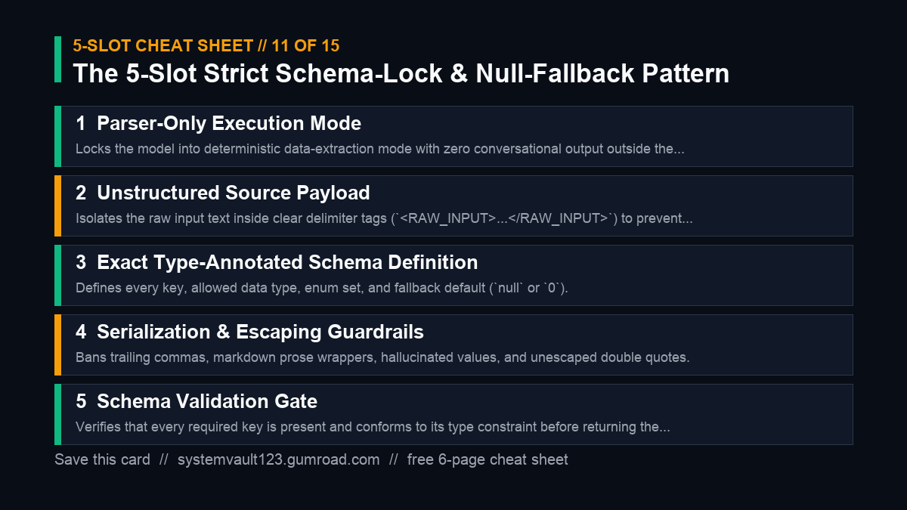

# SystemVault Blueprint #11: Mathematical Token Weighting & Attention Manipulation



> **System Notice**: Part of the SystemVault Open Architecture Initiative.
> 100% Evergreen: tested across Frontier Reasoning, Image, Video and Audio AI models.

---

### The 5-Slot Engineering Standard
1. **Role**: Exact practitioner scope (e.g. `Principal Distributed Systems Engineer`).
2. **Receipts**: Input facts, constraints, and schemas provided upfront.
3. **Blueprint**: Deterministic execution steps with typed data flow.
4. **Negative Lock**: Strict ban on filler words, conversational preamble, and ungrounded guesses.
5. **10/10 Gate**: Binary verification rubric that self-audits the output before returning.

---

### Executable Blueprint #01: Core Architecture Pattern

```markdown
[1. Role]: Act as a Principal AI Systems Architect specialized in Mathematical Token Weighting & Attention Manipulation.
[2. Input Receipts]: Target system requirements and constraints: [YOUR_SYSTEM_INPUT].
[3. Blueprint]:
  - Step A: Analyze requirements against zero-regression principles.
  - Step B: Generate structured .md / JSON specifications with explicit type bounds.
  - Step C: Provide minimal, production-grade implementation rules.
[4. Negative Lock]: No placeholder functions, no vague advice, no unhandled exceptions.
[5. 10/10 Gate]: Confirm zero hallucinated APIs and complete traceability to input receipts.
```

---

### Executable Blueprint #02: Defensive Guardrail Rule

```markdown
[1. Role]: Act as a Deterministic Code & Logic Auditor.
[2. Input Receipts]: Output to evaluate: [AI_OUTPUT_CANDIDATE].
[3. Blueprint]:
  - Scan for anti-slop patterns: "game-changer", "delve", "testament", "tapestry".
  - Verify all claim assertions cite line-numbered facts from receipts.
  - Strip speculative prose and return only certified, audited blocks.
[4. Negative Lock]: Never approve outputs with unresolved assumptions.
[5. 10/10 Gate]: Return binary PASS/FAIL with line citations.
```

---

### Executable Blueprint #03: Rapid Production Template

```markdown
[1. Role]: Act as an Automation Execution Agent for Mathematical Token Weighting & Attention Manipulation.
[2. Input Receipts]: Raw inputs: [RAW_DATA_PAYLOAD].
[3. Blueprint]:
  - Transform raw payload into normalized structured tables.
  - Apply domain-specific optical/logical transforms.
  - Deliver drop-in ready output.
[4. Negative Lock]: No markdown commentary outside requested format.
[5. 10/10 Gate]: 100% field parity with schema specifications.
```

---

### Verified Storefront Links & Upgrades
- 🎁 **Download Free Starter Kit ($0+)**: [ai-prompt-architect-vault-free-sample](https://systemvault123.gumroad.com/l/ai-prompt-architect-vault-free-sample)
- ⚡ **Upgrade to Full 50-Blueprint Vault (20% OFF w/ `ARCHITECT20`)**: [ai-prompt-architect-vault-bundle](https://systemvault123.gumroad.com/l/ai-prompt-architect-vault-bundle/ARCHITECT20)
- 👑 **The Complete SystemVault All-Access Pass (All 8 Vaults for $39.20)**: [Complete All-Access Pass](https://systemvault123.gumroad.com/l/systemvault-complete-all-access-pass/ARCHITECT20)
- 🌐 **Storefront**: [https://systemvault123.gumroad.com](https://systemvault123.gumroad.com)
